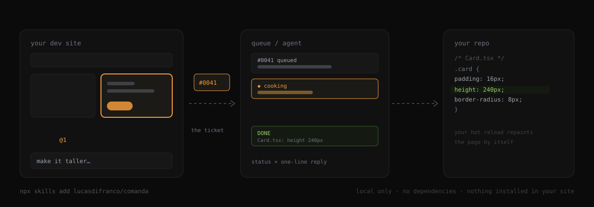

# Comanda

**Point at the page. Say what you want. The agent edits the code.**

Comanda opens your dev site in the browser with an edit overlay. You select the element, mark the area, draw on the screen, or type the change — and your coding agent rewrites the code in the repository. Your own hot reload shows the result. No screenshot, no "the button next to the title", no describing CSS in words.



```bash
npx skills add lucasdifranco/comanda
```

Then, from your repository, with the dev server running:

```
/comanda
```

<table>
<tr><td width="50%">

**Select** — click the items you mean

**Mark area** — drag a box over a region

**Draw** — circle it in red, like on paper

**Edit** — change a value in the inspector and it goes to the code

</td><td width="50%">

**Nothing installed in your site.** Comanda is a local proxy; the overlay is injected into the HTML in flight.

**No dependencies.** Node 18+ and a browser.

**Local only.** Listens on `127.0.0.1`, accepts writes from its own pages.

</td></tr>
</table>

## Install

```bash
npx skills add lucasdifranco/comanda          # project
npx skills add lucasdifranco/comanda -g       # every project (global)
```

The [skills CLI](https://skills.sh) writes the skill into the folder your agent already reads, and you pick the agent — Claude Code, Codex, Cursor, OpenCode, Antigravity, Grok, Gemini CLI, Copilot, Windsurf, Zed, and [75 more](https://github.com/vercel-labs/skills/blob/main/docs/agents.md).

Manual install: copy [`skills/comanda/`](skills/comanda) into your agent's skills folder. See [docs/install.md](docs/install.md) for the path of each agent.

Requirements: **Node.js 18+**, and a dev server already running.

## Use

1. Start your site in dev (`npm run dev`, `python app.py`, whatever it is).
2. In your agent, in the repository of that site, run `/comanda` (or `/comanda http://localhost:5173`).
3. The site opens at `http://127.0.0.1:7780/`. Use the pencil, click **Select**, pick the items, write the request, **Send**.
4. The agent changes the code. Your hot reload repaints the page, and the ticket in the panel turns into `DONE` with a one-line reply.

Sites **without** hot reload (a Python server with the page built in, Go, a binary) work too: give `/comanda` the app command instead of a URL and Comanda restarts the app after each change.

### The panel

Tickets arrive as paper slips in a list: `○ QUEUED` → `◐ COOKING` → `DONE`, with the agent's reply on the stub, plus `? QUESTION`, `↶ UNDONE` and `✕ ERROR`. The chef avatar shows what is being done right now, step by step.

- **Question** — the agent asks on the screen, with options and a free-text field, never in your terminal.
- **Reply** — answer a finished ticket and it becomes a new request on top of it ("make it bigger").
- **Undo** — the last request is reversible from the panel; Comanda kept the original of every file it touched.

## How it works

Comanda is a local proxy in front of your dev server, plus a folder of JSON files that both sides read.

```
browser ──► Comanda proxy (127.0.0.1:7780) ──► your dev server
                     │
                     ├── the overlay (selection, inspector, drawings)
                     └── queue/0041.json  ← the agent writes status here
```

The overlay writes a ticket with what you selected and what you asked. Your agent picks it up, finds the code from the DOM path, the React component chain, the visible text and the computed styles, makes the smallest change, and writes back a status and a reply. No MCP server, no daemon, no account: one process on a socket and plain files on disk.

Protocol and internals: [docs/how-it-works.md](docs/how-it-works.md).

## Limits

- The **Undo** button covers only the last request, and only files that went through `snap.mjs`. The rest is your repository's git.
- The React component name comes from the fiber tree. On sites without React you get html, text and computed styles, which is usually enough.
- Resources requested with an absolute URL to the site origin (e.g. `http://localhost:8081/logo.png`) bypass the proxy.
- One browser, one target at a time. The panel is per page.

## Works with

Any agent that reads a `SKILL.md`: Claude Code · Codex · Cursor · OpenCode · Antigravity · Grok Build · Gemini CLI · GitHub Copilot · Windsurf · Cline · Amp · Droid · Goose · Kiro · Qwen Code · Zed — [full list](https://github.com/vercel-labs/skills/blob/main/docs/agents.md).

The skill is portable on purpose: the queue protocol is plain files, and the one thing the agent has to know is how to run a command and edit a JSON.

## FAQ

**Does it work on Windows?** Yes. Windows, macOS and Linux.

**Does it need an API key or an account?** No. It runs on your machine and your agent does the work.

**Is my code sent anywhere?** No. The proxy is local; the browser, the queue and the agent are all on the same machine.

**Something else?** Open an issue.

## License

MIT.
